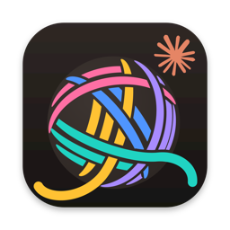
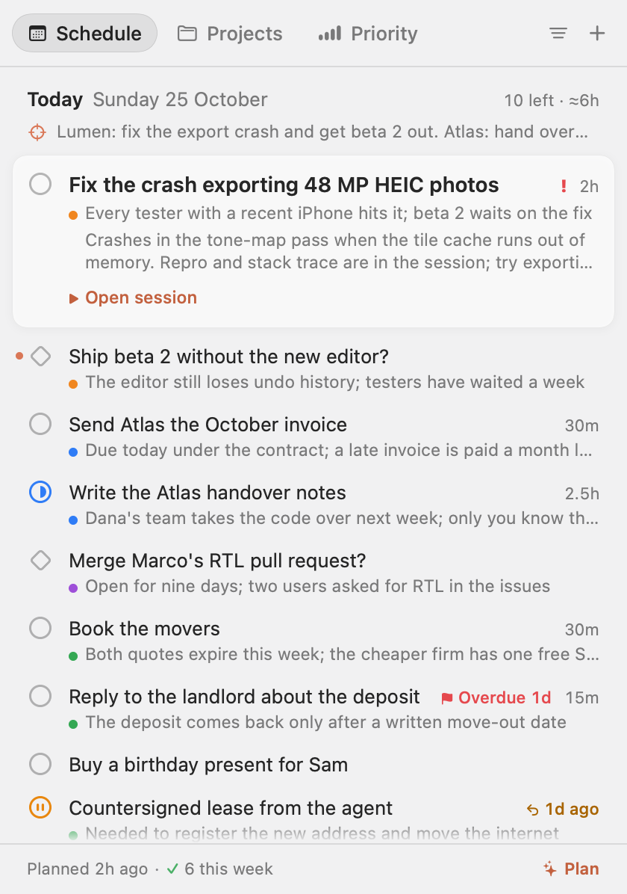
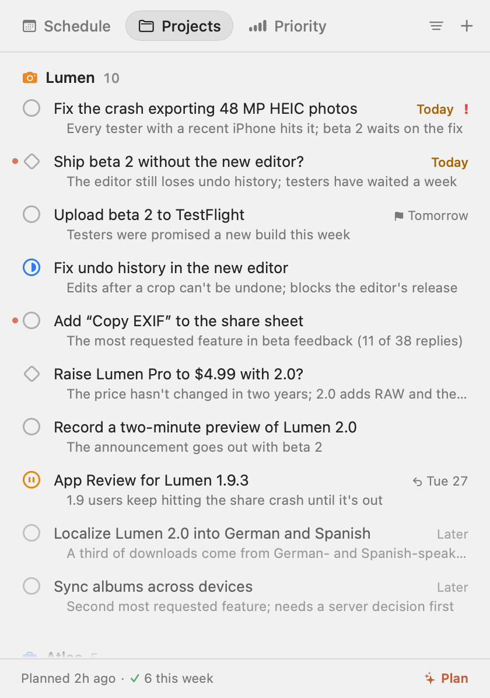
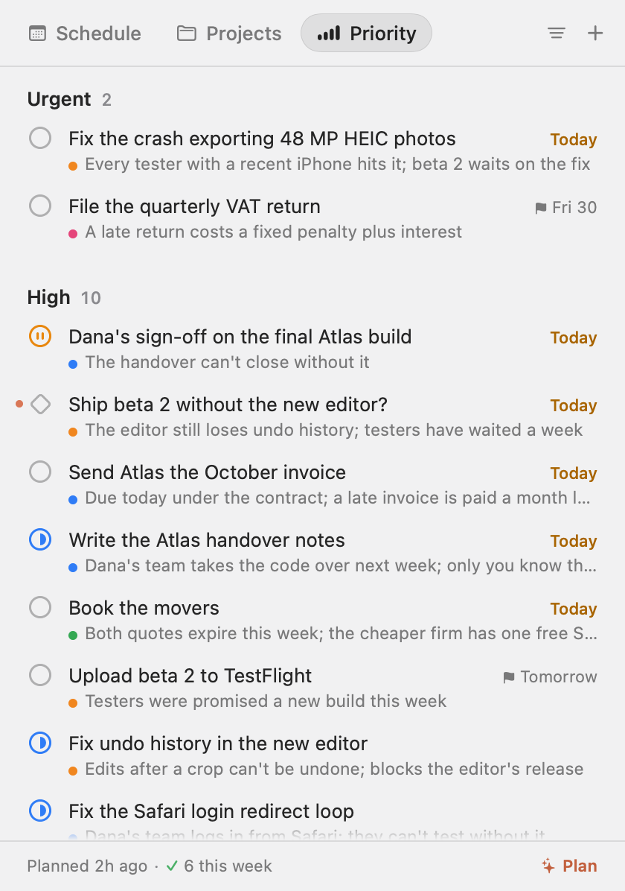
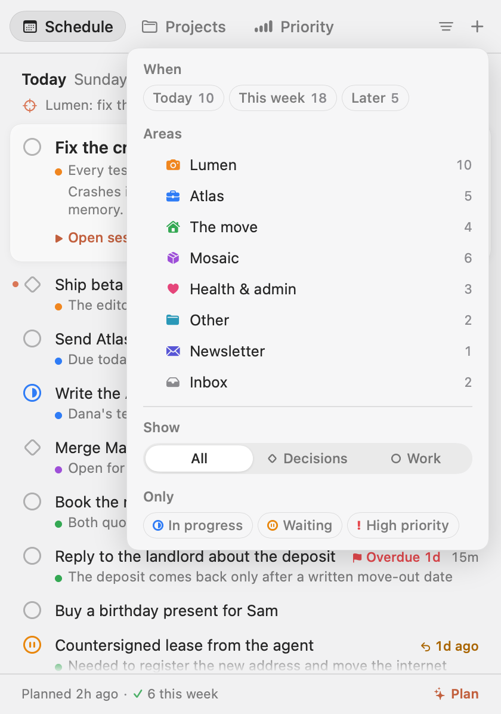
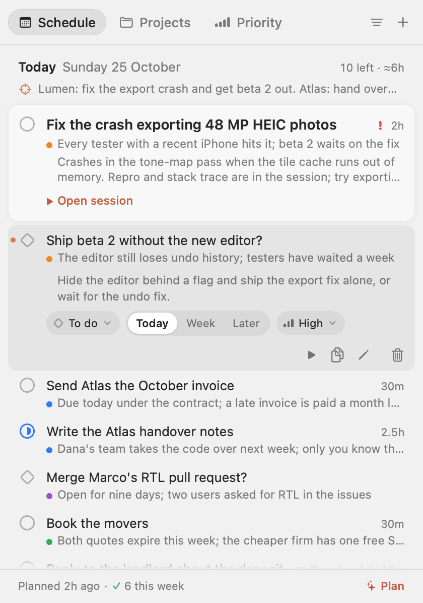
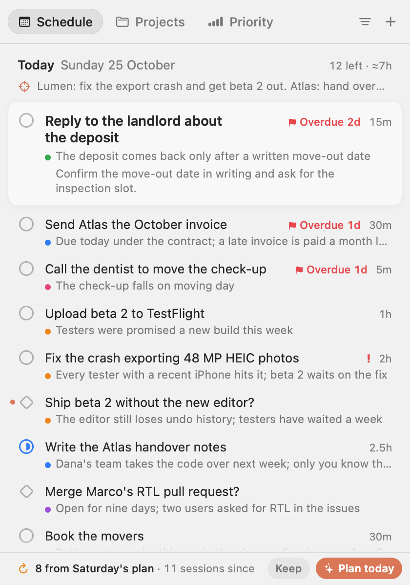

<p align="center"></p>

<h1 align="center">Claudo</h1>

<p align="center">A to-do list in your Mac's menu bar that Claude keeps for you.<br>
It reads your Claude Code sessions and tells you what to do today, this week and later.</p>

<p align="center">
  
  
</p>

<p align="center"><sub>A demo board: the projects and people in the screenshots are made up.</sub></p>

## Why

When you work through many Claude Code sessions at once, each one leaves a loose end: a bug half fixed, a question
waiting for your answer, a build to ship. Claudo gathers them into one board, so you don't have to remember which
session was where.

- **One board.** Tasks for Today, This week and Later, grouped by project, each with a line on why it matters now.
- **First things first.** Today opens with one card: what to do now, the next step, and **Open session** to go
  back into the Claude Code session the task came from.
- **You decide.** Claude suggests, you have the last word: what you add, edit, finish or dismiss stays that way.
  When Claude thinks one of your tasks is done, it asks (**✦ Done?**) instead of closing it.
- **Nothing to set up.** Claudo runs the `claude` command you already have, on your own Claude account. No API key.

The menu bar icon is a ball of yarn that untangles as Today gets done, next to the number of tasks left. A coral dot
means Claude added something you haven't seen yet.

<p align="center">
  <picture>
    <source media="(prefers-color-scheme: dark)" srcset="docs/screenshots/tray-dark.png">
    
  </picture>
</p>

## Install

You need macOS 14 or later and [Claude Code](https://docs.claude.com/en/docs/claude-code), installed and logged in
(`claude` works in Terminal).

**Homebrew**

```sh
brew tap aspasskiy/claudo https://github.com/aspasskiy/claudo
brew install --cask aspasskiy/claudo/claudo
```

Update with `brew upgrade --cask claudo`, remove with `brew uninstall --cask claudo` (`--zap` also deletes the
board and the settings).

**Download.** Get `Claudo-<version>.dmg` from [Releases](https://github.com/aspasskiy/claudo/releases), open it and
drag Claudo to Applications. Releases are signed with Developer ID and notarized by Apple, so they open without
Gatekeeper warnings.

**From source.** See [Development](#development).

## First run

1. Open Claudo. It lives in the menu bar only, with no Dock icon: look for the ball of yarn.
2. Click it and press **✦ Plan with Claude**. The first run reads the last 30 days of sessions, so it takes a while
   (about a quarter of an hour for a busy month). The bar at the bottom shows how far it got. Later runs reuse what
   was already read and are quicker.
3. Start at the top of Today.

Plan again whenever the board feels out of date (⌘R). For a fresh board every day, right-click the icon and turn on
**Plan Every Morning at 9:00**.

## Everyday use

Click the icon for the board, right-click it for the menu.

**Three views** of the same tasks, switched by the tabs at the top:

- **Schedule** (⌘1): Today, This week, Later, then what you got done this week.
- **Projects** (⌘2): the tasks by project.
- **Priority** (⌘3): Urgent, High, Medium, Low.

The **filter** (⌘F) narrows every view: Today, This week or Later, areas, decisions or work, in progress, waiting,
high priority.

<p align="center">
  
  
</p>

**Reading a row**

| Mark | Means |
|---|---|
| ○ | a task: something to do |
| ◇ | a decision: a call to make, not hours to spend |
| blue half-filled mark | in progress |
| amber ⏸ | waiting on someone else; `↩ Tue 27` is the day to check back |
| coral dot on the left | new from Claude, not seen yet |
| red ! | urgent |
| ⚑ Today, ⚑ Overdue 1d | a deadline |
| 30m, 2h | how long Claude thinks it takes |

**Doing things**

| Action | Does |
|---|---|
| Click ○ or ◇ | Mark done |
| ⌥-click it | To Do → In Progress → Waiting |
| Right-click it | Choose a status |
| Hover a row | ▶ Open session, move it to Not today / Today / This week |
| Click a row | Details: status, when, priority, Open session, copy, rename, remove |
| Double-click a title | Rename |
| ⌘N | New task |
| ⌘F | Filter |
| ⌘R | Plan now |
| ⌘Z | Undo a removal |

When the board was planned on an earlier day, the bar at the bottom says so and offers **Keep** or **✦ Plan today**.

<p align="center">
  
  
</p>

**The right-click menu:** Plan Now, Look Back (7, 14 or 30 days), Language, Plan Every Morning at 9:00 (off by
default), Launch at Login, Show Data Folder, Quit Claudo.

## Good to know

**Made for one way of working.** The planner assumes someone who runs several lines of work at once through
parallel Claude Code sessions, with about 5 hours of their own attention a day (4–5 at weekends), weekends included,
in a day that runs 07:00–23:00. Today is capped at that budget and the hours left. To plan for a different week,
change the rules in `Sources/ClaudoCore/PlanPrompt.swift`.

**Language.** The interface is in English or Russian and follows the system language; right-click › **Language**
switches it. Claude writes the board in the same language. With a system language other than English or Russian,
the interface is English and Claude writes in your language.

**Cost.** Each plan run uses your Claude subscription. As a guide: a 30-day run takes about 9 minutes and would cost
about $4 at API list price, plus about 5 minutes and $1.90 the first time to read a busy month of sessions (about
600); after that only new sessions are read. A 7-day look-back is faster and cheaper. Nothing runs until you press
Plan.

**Privacy.** Everything stays on your Mac except what `claude -p` sends to Anthropic under your own Claude account:
the digest (excerpts of your prompts and Claude's replies, session titles, project memory indexes, folder paths,
branch names and commit subjects) and the current board. Claudo only reads `~/.claude/projects` and runs read-only
`git` commands (`--no-optional-locks`) in the repos you worked in. It writes only to its data folder,
`~/Library/Application Support/Claudo` (right-click › Show Data Folder):

| File | What |
|---|---|
| `board.json` | the board |
| `sessions-cache-sonnet.json` | Sonnet's session notes (`sessions-cache.json` holds Haiku's, from the CLI) |
| `last-digest.txt` | exactly what the last plan run read |
| `last-result.json` | the last run's raw answer |
| `last-run.json` | where the last run's time and money went |
| `run/` | the working folder `claude -p` runs in, so no project's `CLAUDE.md` loads |
| `resume.command` | the script **Open session** runs in Terminal |

Settings are in the app's UserDefaults. Launch at Login writes a LaunchAgent,
`~/Library/LaunchAgents/site.spasskiy.claudo.plist`.

## How it works

1. **Read.** Claudo scans the top-level Claude Code transcripts in `~/.claude/projects/*/*.jsonl` from the look-back
   window: your prompts, Claude's last reply, Claude Code's recap and session titles. Tool traffic and subagents are
   skipped. It adds the `memory/MEMORY.md` indexes of the active projects and a read-only `git status` of the week's
   repos (branch, uncommitted files, unpushed commits).
2. **Summarize.** Sonnet writes a short note per session: what happened, its state, and what is left open. Notes are
   cached, so later runs only send new or changed sessions.
3. **Plan.** Opus reads the notes (the last 7 days in more detail), the git state and the current board, and answers
   with projects, a focus line, tasks and the tasks it closes, each with a reason.
4. **Merge.** The answer is folded into the board. Fields you set by hand are never overwritten, and tasks the run
   doesn't mention stay as they are.

All model calls go through the local `claude` CLI (`claude -p` with a JSON schema, no tools, no MCP servers, no
saved session). Claudo looks for `claude` in `~/.local/bin`, `/opt/homebrew/bin`, `/usr/local/bin` and
`~/.claude/local`. The full design is in [DESIGN.md](DESIGN.md).

## Development

Needs Swift 6 (Xcode 16 or later, or the matching Command Line Tools).

```sh
./build.sh             # builds build/Claudo.app (release, ad-hoc signed)
./build.sh --install   # also copies it to /Applications and (re)launches it
swift build
swift test             # merge rules, views, digest, decoding, compaction, git state, the app's helpers
```

A source build is signed ad hoc and only meant for your own Mac. No test calls a model. `Fixtures/board-v4.json`
and `Fixtures/board.json` are synthetic boards.

The app renders its popover to PNGs without a menu bar, for checking layouts in both appearances and languages (the
screenshots above are renders of `Fixtures/board-v4.json`):

```sh
.build/debug/Claudo --render /tmp/renders --board Fixtures/board-v4.json [--appearance dark] [--language ru] \
    [--group project] [--state running|stale|error|…] [--expand <task-id>] [--filter-open] [--full]
```

Without `--board` it reads your real board, read-only; it never writes. The flags are listed in
`Sources/Claudo/Render.swift`. See [CONTRIBUTING.md](CONTRIBUTING.md) before sending a change.

`./build.sh --release` signs the app with Developer ID, notarizes it and writes `build/Claudo-<version>.zip` and
`.dmg` for the release, with their SHA-256 (the zip's goes into `Casks/claudo.rb`).

### CLI

`claudo-cli` runs the same pipeline without the UI. Commands marked † call `claude` and spend subscription quota.

```sh
swift build -c release
.build/release/claudo-cli [--data-dir <dir>] <command>
```

| Command | Does |
|---|---|
| `digest [--days N] [--compact off\|haiku\|sonnet]` | print what a plan run would send; `--compact` previews it from the session cache and calls nothing |
| `prompt [--language L]` | print the planner's system prompt and answer schema |
| `plan [model] [--days N] [--compact …] [--effort E] [--compact-effort E] [--language L]` † | run, merge into the board and save (Sonnet, no compaction and effort `xhigh` unless told otherwise) |
| `compact [--model haiku\|sonnet] [--effort E] [--days N] [--limit N] [--language L] [--dry-run]` † | summarize the uncached sessions into that model's cache; `--dry-run` only counts them |
| `cache [--model haiku\|sonnet] [--days N]` | what that model's session cache holds |
| `raw <session-id…> [--days N]` | the blocks the summarizer reads for these sessions |
| `board [file]` | print a board as the app lists it |
| `merge <board.json\|-> <answer.json> [--out file]` | fold a saved answer into a board offline |

`--data-dir` points every command at another data folder (a scratch one for experiments). `--language` takes a code
or a name (`ru`, `pt-BR`, `Russian`); by default it is the app's Language setting, else the system's language. Run
`claudo-cli help` for the full text.

### Project layout

```
Sources/ClaudoCore/   model, session scanner, git state, digest, prompts, summarizer, planner, merge, storage
Sources/Claudo/       the menu bar app (SwiftUI + AppKit) and the debug renderer
Sources/claudo-cli/   the terminal harness
Tests/                ClaudoCoreTests (no model calls) and ClaudoTests (the app's pure helpers)
Fixtures/             synthetic boards for tests and renders
Resources/, tools/    the app icon and the script that draws it
docs/screenshots/     the README's pictures
build.sh, Info.plist  app bundle and release
Casks/claudo.rb       Homebrew cask (this repo doubles as its tap)
```

## License

MIT, see [LICENSE](LICENSE).
